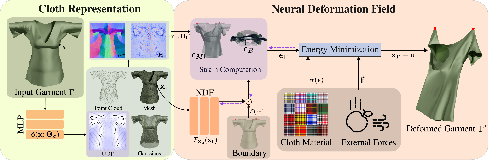

# NeuralGarSim: Geometry-agnostic Garment Simulation with Neural Fields

Official implementation for "NeuralGarSim: Geometry-agnostic Garment Simulation with Neural Fields", accepted at ECCV 2026.

### [Project Page](https://4dqv.mpi-inf.mpg.de/NeuralGarSim/) | [Paper](https://eccv.ecva.net/virtual/2026/poster/5963) | [Video](https://youtu.be/ioUgaS19fY4)

Arihant Gaur, Navami Kairanda, Christian Theobalt, Vladislav Golyanik

[](https://youtu.be/ioUgaS19fY4)

## News

- NeuralGarSim has been accepted to the European Conference on Computer Vision (ECCV) 2026.

## Method Scope

The public core simulator in `src/garment_tdc/` implements a quasi-static Kirchhoff-Love shell energy using tangential differential calculus directly in 3D Euclidean space.

The Belytschko validation experiments are present under `experiments/belytschko/`.

## Installation

Use Python 3.10 or newer. First install PyTorch for your CUDA version, then PyTorch3D, then this package:

```bash
conda create -n neuralgarsim python=3.10
conda activate neuralgarsim
pip install torch                # pick the build for your CUDA version from pytorch.org
pip install --no-build-isolation "git+https://github.com/facebookresearch/pytorch3d.git@stable"
pip install -e ".[render,dev]"
```

PyTorch3D has no PyPI wheels, so it is not listed in `pyproject.toml`; see its [install guide](https://github.com/facebookresearch/pytorch3d/blob/main/INSTALL.md) for prebuilt alternatives. The `render` extra adds PyVista for GIF rendering, and `dev` adds pytest.

Check the install with the test suite and a two-iteration smoke run that needs no mesh:

```bash
python -m pytest
python run_garment_tdc.py -c configs/garments/smoke_test.ini
```

## Repository Structure

- `src/garment_tdc/`: core TDC garment simulator
- `run_garment_tdc.py`: for training NeuralGarSim
- `configs/garments/`: garment configs
- `material/`: material parameter configs
- `experiments/belytschko/`: standalone TDC and NeuralClothSim physical validation scripts
- `scripts/preprocess/`: optional mesh and Gaussian preprocessing helpers
- `scripts/evaluate/`: post-processing metrics
- `scripts/render/`: mesh sequence rendering helper
- `logs/`: generated outputs
- `data/garments/`: garment meshes (one sample T-shirt included)

## Running a Garment Simulation

One sample garment ships with the repository: `data/garments/tee.obj`, a T-shirt from the Korosteleva and Lee garment dataset (CC BY 4.0, see Acknowledgements). It is already centred, scaled and Z-up. Simulate it with two handle vertices fixed under gravity:

```bash
python run_garment_tdc.py -c configs/garments/tee.ini
```

For your own garment, place the OBJ under `data/garments/` and set the mesh and boundary condition in a config, for example:

```ini
reference_geometry_name = mesh
reference_geometry_type = udf
reference_geometry_source = data/garments/my_garment.obj
boundary_condition_name = mesh_vertices_moved
reference_boundary_vertices = [210, 704]
moved_boundary_mode = towards
moved_boundary_displacement = 0.05
material_type = linear
```

Outputs are written to `logs/<expt_name>/`, including:

- `args.ini`: experiment config copy
- `reference_state.obj`: normalised rest-state mesh
- `meshes/<step>/000.obj`: simulated mesh snapshots
- `weights/*.tar`: deformation-field checkpoints
- TensorBoard event files when `debug = True`

## Config Notes

Important fields:

- `expt_name`: output directory name under `logging_dir`
- `reference_geometry_name`: `mesh` for arbitrary garments, or analytical examples such as `rectangle_xy`
- `reference_geometry_type`: `mesh`, `udf`, `pcd`, or `gaussians`
- `reference_geometry_source`: OBJ path for mesh garments
- `boundary_condition_name`: mesh garment runs support `mesh_vertices`, `mesh_vertices_moved`, and `free_fall`
- `reference_boundary_vertices`: fixed or moved mesh-handle vertex IDs
- `moved_boundary_mode`: for `mesh_vertices_moved`, move the two selected vertices `away` from each other or `towards` each other
- `moved_boundary_displacement`: displacement distance for each selected vertex when using `mesh_vertices_moved`
- `gravity_acceleration`: fully uniform 3D body force/gravity vector, for example `[0, 0, -9.8]`
- `material_type`: preset name such as `cotton`, `silk`, `canvas`, or `linear_1`
- `material_filepath`: optional material config path; if omitted, preset material names resolve to files under `material/`
- `domain_u_max`, `domain_v_max`: analytical-surface bounds only; mesh, PCD, and Gaussian garment runs ignore them
- `train_n_spatial_samples`, `n_iterations`, `lrate`: training controls
- `preprocess_mesh`: run OBJ normalisation before the simulation
- `preprocess_output_dir`, `preprocess_prefix`: where optional preprocessed meshes are saved
- `preprocess_axis_transform`: defaults to `none`; use `y_to_z` or `y_to_minus_z` only for datasets that need a right-handed axis conversion
- `run_render`: render the saved mesh sequence as GIFs after training
- `render_views`: camera views to save, for example `[1, 2]`

## Input Mesh Format

Garment inputs should be triangulated OBJ meshes. Meshes may include UVs, but UVs are not required for the TDC formulation. The loader recentres and normalises the mesh internally, stores the normalisation, and writes the normalised rest state to the experiment log directory.

For mesh-vertex boundary conditions, vertex IDs refer to the input mesh vertex indexing. They can be potentially obtained by loading the mesh inside MeshLab.

## Belytschko Experiments

Run the TDC validation script:

```bash
python experiments/belytschko/run_tdc.py --help
python experiments/belytschko/run_tdc.py --experiment square_plate
```

Run the NeuralClothSim baseline script:

```bash
python experiments/belytschko/run_neuralclothsim.py --help
python experiments/belytschko/run_neuralclothsim.py --experiment square_plate
```

These are standalone benchmark scripts.

## Rendering and Evaluation

Render a saved mesh sequence:

```bash
python scripts/render/render_mesh_sequence.py --help
```

Compare two manually selected meshes:

```bash
python scripts/evaluate/quantitative_metrics.py \
  --reference logs/run_a/meshes/3000/000.obj \
  --meshes logs/run_b/meshes/3000/000.obj \
  --output metrics_run_a_vs_run_b.json
```

Preprocessing helpers accept explicit input/output paths. For example:

```bash
python scripts/preprocess/normalize_mesh_asset.py \
  --input data/raw/dress.obj \
  --output-dir data/garments \
  --axis-transform none
```

The same preprocessing can be enabled from a config:

```ini
preprocess_mesh = True
preprocess_output_dir = data/garments/processed
preprocess_prefix = normalised_
preprocess_centre_method = mean
preprocess_target_max_abs = 1.0
preprocess_axis_transform = none
```

The OBJ normaliser rewrites only vertex coordinate records (`v ...`) and leaves face records and vertex order unchanged, so MeshLab vertex IDs remain valid after preprocessing.

Rendering can also be run automatically after training:

```ini
run_render = True
render_views = [1, 2]
render_output_dir = logs/dress_rebuttal
```

## Citation

```bibtex
@inproceedings{gaur2026neuralgarsim,
  title={NeuralGarSim: Geometry-agnostic Garment Simulation with Neural Fields},
  author={Gaur, Arihant and Kairanda, Navami and Theobalt, Christian and Golyanik, Vladislav},
  booktitle={European Conference on Computer Vision (ECCV)},
  year={2026}
}
```

See `CITATION.cff` for GitHub citation metadata.

## Acknowledgements

This repository builds on ideas and components from the following open-source projects:

- [navamikairanda/neuralclothsim](https://github.com/navamikairanda/neuralclothsim)
- [vsitzmann/siren](https://github.com/vsitzmann/siren)
- [LIA-DiTella/DiffUDF](https://github.com/LIA-DiTella/DiffUDF)

The nonlinear material presets (`cotton`, `silk`, `canvas`) use the fitted parameters of Clyde et al., [Modeling and Data-Driven Parameter Estimation for Woven Fabrics](https://doi.org/10.1145/3099564.3099577), SCA 2017.

The sample garment `data/garments/tee.obj` is from the [Dataset of 3D Garments with Sewing Patterns](https://doi.org/10.5281/zenodo.5267549) by Maria Korosteleva and Sung-Hee Lee (NeurIPS 2021 Datasets and Benchmarks), licensed [CC BY 4.0](https://creativecommons.org/licenses/by/4.0/). We centred and scaled it and rotated it to Z-up.

Copyright and licence notices for third-party code and data are in `THIRD_PARTY_NOTICES.md`.

## License

This software is provided freely for non-commercial use. We release this code under the MIT license, which you can find in the file LICENSE.
